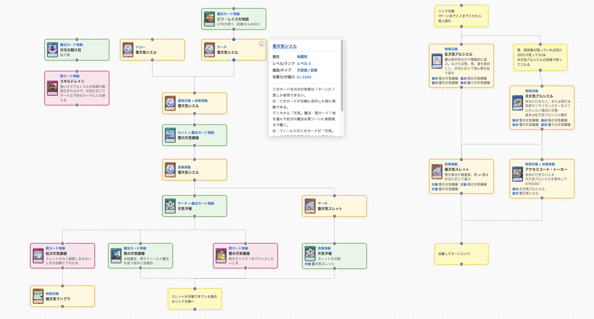

# DuelFlow

遊戯王のコンボルートを視覚的に作成・管理する Web アプリです。

## 使い方

1. 遊戯王ニューロンからデッキレシピをダウンロードします
2. 画面上部の「デッキを追加」ボタンから、1.でダウンロードしたデッキレシピファイルをアップロードします
3. サイドバーに追加したデッキのカードが一覧表示されるので、画面中央のキャンバスにドラッグ & ドロップします
4. カードノードをクリックしてアクションなどの編集をします
5. カードノードにあるハンドルをドラッグして、別のカードノードと接続し、展開ルートを作成します
6. 完成したら「展開ファイルの保存」でJSONファイルとして書き出せます

## ノードを置く

- 左サイドバーのカード一覧からカードをドラッグ＆ドロップすると、**アクションノード**が作成されます。
- カード一覧の一番上にある「メモ」アイテムをドラッグ＆ドロップすると、**メモノード**が作成されます。
- ノードは自由にドラッグして移動できます。

## ノードを繋ぐ

- ノード上部・下部のハンドル（青い丸）をドラッグし、別のノードのハンドルに近づけると接続線が作成されます。
- 接続線を選択するとラベルを編集できます。
- 選択中の接続線は `Delete` / `Backspace` で削除できます。

## ノードを編集・削除

- ノードをクリックすると編集モードになります。フォーム外をクリックすると保存されます。
- ノードにマウスを合わせると右上に削除ボタンが表示されます。
- ノードを選択している状態で `Delete` / `Backspace` を押すと削除できます。

## デッキ・ルートの操作

- ヘッダー中央のデッキ名をクリックすると、デッキの切り替え・名前変更・削除、および「デッキを追加」ができます。
- 「デッキを追加」では、遊戯王NEURONのデッキページを保存したHTMLフォルダからカードをインポートできます。
- 「ルートをクリア」で現在のルートのノードと接続線をまとめて削除できます。
- 「展開ファイルの保存/読み込み」でコンボデータを JSON としてエクスポート・インポートできます。

## ショートカット

| 操作                         | 内容                         |
| ---------------------------- | ---------------------------- |
| `Shift + ?`                  | 使い方を表示                 |
| `Ctrl + Z / Cmd + Z`         | 元に戻す                     |
| `Ctrl + Y / Cmd + Shift + Z` | やり直し                     |
| `Delete / Backspace`         | 選択中のノード・接続線を削除 |
| ホイール                     | キャンバスを上下にパン       |
| `Shift + ホイール`           | キャンバスを左右にパン       |
| `Cmd / Ctrl + ホイール`      | キャンバスをズーム           |

## 開発者向け情報

開発環境の構築やコマンド、プロジェクト構成などは [CONTRIBUTING.md](./CONTRIBUTING.md) を参照してください。
